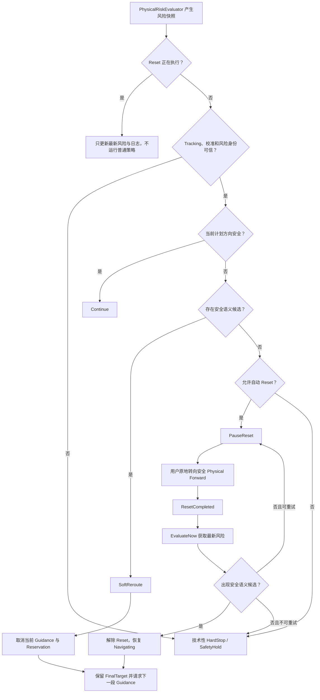

# VirtualGuidance 运行期安全重规划与自动 Reset 优化方案

## 1. 文档目的

本文档记录 VirtualGuidance 运行期物理风险处理链路的最小侵入优化方案。方案解决当前系统在检测到 `critical` 风险后过早进入 `SafetyHold`、跳过语义重规划并等待研究员干预的问题。

优化后的目标行为为：

```text
有安全候选 -> 自动重规划
无安全候选 -> 自动 Reset
Reset 后出现安全方案 -> 自动重新规划
基础事实不可信或自动恢复确实失败 -> 才保持 HardStop
```

本方案不改变任务定义、不替换任务最终目标、不新增大型状态机，也不修改场景、Prefab 或 Inspector 配置。

## 2. 已确认的问题

### 2.1 当前暂停的直接原因

当前风险快照变为 `critical` 后，`ExperimentDashboard.HandleRiskStateChanged` 直接调用 `EnterSafetyHold("critical physical risk")`。该入口会：

1. 取消当前 Guidance；
2. 释放当前目标和候选集合 Reservation；
3. 将任务切换为 `PausedForReset`；
4. 启动 `PauseResetController`；
5. 将实验状态切换为 `SafetyHold`。

与此同时，`GuidanceCoordinator` 也订阅相同的风险事件，并具有 `Continue / SoftReroute / HardStop` 决策能力。Dashboard 对原始风险的直接响应会抢先清理 Coordinator 的活动上下文，使已有的自动重规划链路无法稳定完成。

### 2.2 当前语义混淆

现有 `HardStop` 同时表达了两类不同情况：

- 技术条件不可信，系统不能继续安全决策；
- 暂时没有安全语义候选，但可以通过原地安全转向恢复。

两者后续处理完全不同。前者应保持停止，后者应自动执行 Reset 并重新规划，因此必须在决策层显式区分。

### 2.3 Reset 恢复链路没有完全收口

现有代码已经提供：

- `PauseResetController` 的 `Required -> TurningToSafeDirection -> Completed -> Inactive` 生命周期；
- `GuidanceCoordinator.ResumeAfterResetAndReplan()`；
- Reset 完成后的即时风险重算。

但恢复流程仍由 Dashboard 的 `ResumeSessionWithRisk()` 编排，并带有旧的 `SafetyHold` 和研究员恢复语义。Reset 完成后的风险判断没有完全回到 Coordinator 的统一安全策略。

## 3. 优化目标与非目标

### 3.1 优化目标

1. 当前方向危险且存在安全语义候选时，自动取消当前引导并重新规划。
2. 当前方向危险且不存在安全语义候选时，自动启动可恢复的 PauseReset。
3. Reset 执行期间不重复运行普通安全策略，不重复启动 Reset。
4. Reset 完成后使用最新 Physical Pose 重算风险，并重新进入 Coordinator 的统一决策链路。
5. 只有基础安全事实不可信、用户越界或有限次自动恢复仍失败时才保持 HardStop。
6. 无论发生多少次重规划或 Reset，任务最终目标和完成条件保持不变。

### 3.2 非目标

- 不新增全局事件总线。
- 不重写现有任务状态机。
- 不改变后端协议和 Guidance DTO。
- 不放宽 `LocalGuidanceValidator` 的安全校验。
- 不修改 `PhysicalRiskEvaluator` 当前的风险阈值。
- 不把研究员按钮删除；人工入口继续作为调试和实验运维工具。

## 4. 核心语义约束

### 4.1 三类目标必须保持独立

| 目标类型 | 示例 | 重规划时是否可变 | 用途 |
| --- | --- | --- | --- |
| `FinalTarget` | `E5` | 否 | 任务最终完成条件 |
| `PreferredTaskTarget` | `E5` | 否 | 每次 Guidance 请求希望继续推进的任务目标 |
| `GuidanceTarget` | `E3`、`E4` | 是 | 当前一段实际执行的语义引导目标 |

语义重定向只替换当前 `GuidanceTarget` 和对应 Reservation，不能修改 `GuidanceTaskDefinition.finalTargetId`、运行期 `finalTargetId` 或最终目标完成条件。

### 4.2 临时目标不能完成任务

到达安全候选只表示当前一段 Guidance 完成。只有现有任务到达确认链路确认用户到达任务要求的最终目标后，`GuidanceRuntimeState.IsCompleted` 才能成立。

例如：

```text
原计划：E1 -> E3 -> E5
风险重定向：E1 -> E4 -> E5
最终目标：E5，始终不变
```

## 5. 目标决策模型

### 5.1 决策类型

在 `RuntimeGuidanceSafetyDecision` 中增加 `PauseReset`：

```csharp
public enum RuntimeGuidanceSafetyDecision
{
    Continue,
    SoftReroute,
    PauseReset,
    HardStop
}
```

| 决策 | 含义 | 是否进入 `SafetyHold` | 后续动作 |
| --- | --- | --- | --- |
| `Continue` | 当前计划仍可安全执行 | 否 | 保持当前 Guidance |
| `SoftReroute` | 当前计划危险，但存在安全语义候选 | 否 | 自动取消当前 Guidance 并重新请求 |
| `PauseReset` | 暂无安全语义候选，但物理事实可信且可尝试安全转向 | 否 | 自动执行 Reset，完成后重新决策 |
| `HardStop` | 技术条件不可信或自动恢复已经失败 | 是 | 保持停止并等待基础条件恢复或运维处理 |

### 5.2 技术性 HardStop 的边界

以下情况属于技术性或不可继续恢复的 HardStop：

- XR Tracking 无效或丢失；
- Physical Space Calibration 无效；
- Physical Space、Calibration ID 或风险快照身份不匹配；
- 风险快照为空、过期或结构不完整；
- Coordinator 的关键安全依赖缺失；
- 用户已经越出物理边界；
- 所有方向 clearance 都不足以形成有意义的安全转向；
- 自动 Reset 达到最大次数后仍没有安全语义候选。

### 5.3 可恢复 PauseReset 的边界

以下情况使用 PauseReset：

- 当前计划方向危险；
- 当前没有物理安全且语义合法的替代候选；
- Tracking、校准、Physical Space 和风险快照身份都可信；
- 用户仍在物理边界内；
- 风险数据能够提供一个 clearance 相对更大的安全转向方向；
- 尚未超过自动恢复次数上限。

`reset_required` 当前表示 forward、left、right 三个自然方向均不能直接执行移动 Guidance。它应触发 PauseReset，而不是直接代表技术性 HardStop。

## 6. 完整运行流程



## 7. 最小侵入实现方案

### 7.1 `RuntimeGuidanceSafetyPolicy.cs`

职责保持为纯 C#、无副作用的安全决策，不访问 GameObject，不发送请求。

调整内容：

1. 在 `RuntimeGuidanceSafetyDecision` 中增加 `PauseReset`。
2. 将技术事实校验与可恢复风险判断分开。
3. 当前方向达到 critical 时不等待第二个风险样本。
4. 普通 unsafe 保留两个不同风险快照的防抖。
5. 有安全候选优先 `SoftReroute`，无候选才 `PauseReset`。
6. Reset 生命周期处于活动状态时不运行普通策略。

建议伪代码：

```csharp
public RuntimeGuidanceSafetyDecision Evaluate(RuntimeGuidanceSafetyInput input)
{
    if (!HasTrustedSafetyFacts(input))
    {
        return RuntimeGuidanceSafetyDecision.HardStop;
    }

    if (IsResetActive(input.ResetState))
    {
        return RuntimeGuidanceSafetyDecision.Continue;
    }

    var plannedDirectionUnsafe =
        input.PlannedDirectionCritical ||
        Contains(input.LatestRisk.unsafe_directions, input.PlannedDirection);

    if (!plannedDirectionUnsafe)
    {
        return RuntimeGuidanceSafetyDecision.Continue;
    }

    if (!input.PlannedDirectionCritical &&
        input.ConsecutiveUnsafeSamples < UnsafeSamplesRequiredForReroute)
    {
        return RuntimeGuidanceSafetyDecision.Continue;
    }

    return input.SafeCandidateAvailable
        ? RuntimeGuidanceSafetyDecision.SoftReroute
        : RuntimeGuidanceSafetyDecision.PauseReset;
}
```

Reset 活动状态在 Coordinator 入口已经提前返回。策略层保留该分支仅作为防御性保护，不能用 `Continue` 的返回结果恢复或执行旧 Guidance。

### 7.2 `GuidanceCoordinator.cs`

Coordinator 成为运行期安全动作和 Reset 后恢复决策的唯一业务所有者。

#### 7.2.1 增加 Reset 抑制门

```csharp
private bool IsResetRecoveryActive =>
    pauseResetController != null && pauseResetController.IsActive;
```

以下入口在 Reset 活动期间提前返回：

- `HandleRuntimeRiskStateChanged`；
- `HandleGainReevaluationRequested`；
- `HandleRotationGainLifecycleEvent` 中可能触发风险干预的分支；
- 其他由 Reset 中止 Gain 后可能间接触发普通干预的入口。

风险计算器继续更新 `CurrentRiskState`，日志也继续记录，但不重复运行普通策略、不重复启动 Reset、不重复取消 Guidance。

#### 7.2.2 保留 SoftReroute 现有链路

`TriggerSoftReroute()` 继续执行：

```text
取消待处理请求
-> 清除 Guidance 表现
-> 中止 Rotation Gain
-> 停止到达监听
-> 释放 Reservation
-> 清理活动响应和快照
-> 将请求阶段标记为 Cancelled
-> 发布 SoftReroute 和 Replanning
-> RequestNextGuidance
```

新请求继续携带任务原有 `preferred_task_target` 和 `final_target`。

#### 7.2.3 增加 PauseReset 动作

建议新增私有入口：

```csharp
private void TriggerPauseReset(
    GuidanceResponse response,
    PhysicalRiskState riskState,
    string reason)
```

该入口负责：

1. 取消当前 Guidance、Gain、到达监听和 Reservation；
2. 使旧请求与旧响应失效；
3. 将任务切换为 `PausedForReset`；
4. 调用 `PauseResetController.PauseForReset(reason, riskState)`；
5. 发布 `RuntimeInterventionInfo`，决策为 `PauseReset`；
6. 自动 Reset 计数只在真正启动新 Reset 时增加一次。

它不将请求阶段标记为技术失败，不进入 `SafetyHold`，也不等待研究员恢复。

#### 7.2.4 Reset 后统一复验

新增或改造公开入口：

```csharp
public void ReevaluateAfterReset()
```

前置条件：

- `PauseResetController.State == Completed`；
- 任务阶段为 `PausedForReset`；
- 当前没有另一轮恢复决策正在执行。

建议流程：

```csharp
public void ReevaluateAfterReset()
{
    if (!CanReevaluateCompletedReset())
    {
        return;
    }

    var riskState = riskEvaluator != null ? riskEvaluator.EvaluateNow() : null;
    if (!HasTrustedRecoveryFacts(riskState))
    {
        TriggerTechnicalHardStop(
            "Reset completed but the latest risk state is unavailable or invalid.");
        return;
    }

    var safeCandidate = FindRecoverySafetyCandidate(riskState);
    if (safeCandidate != null)
    {
        CompleteResetAndReplan();
        return;
    }

    if (CanRetryAutomaticReset(riskState))
    {
        RestartAutomaticReset(riskState);
        return;
    }

    TriggerTechnicalHardStop(
        "Automatic reset could not produce an eligible safety candidate.");
}
```

成功恢复时调用顺序必须固定为：

```text
PauseResetController.ResumeAfterReset()
-> GuidanceTaskController.ResumeAfterReset()
-> 清零自动 Reset 次数
-> 发布 Replanning
-> RequestNextGuidance()
```

必须先解除 Reset，再将任务恢复为 `Navigating`，之后才能构建候选集合、创建 Reservation 和请求 Guidance。

#### 7.2.5 有限自动恢复

在 Coordinator 内增加最小恢复预算：

```csharp
private const int MaxAutomaticResetAttempts = 2;
private int automaticResetAttempts;
```

规则：

- 初次无安全候选时执行第 1 次 Reset；
- Reset 完成后仍无候选且仍可安全转向时执行第 2 次 Reset；
- 第 2 次完成后仍无候选，升级为 HardStop；
- Reset 期间重复风险事件不增加次数；
- 找到安全候选、任务结束或会话重新开始时清零；
- Tracking、校准或风险身份失效时不消耗次数，直接 HardStop；
- 用户越界或没有有意义的转向 clearance 时直接 HardStop。

### 7.3 `ExperimentDashboard.cs`

Dashboard 收敛为实验状态展示、研究员入口和日志桥接层，不再对运行期原始风险做独立业务决策。

#### 7.3.1 移除抢先暂停

`HandleRiskStateChanged` 保留风险日志，但在 `Running` 状态不再直接调用 `EnterSafetyHold`。

保留的 fail-closed 兜底：

- `Completing` 阶段没有活动 Guidance 时出现 critical 风险；
- Coordinator 缺失；
- Tracking 或校准事件直接报告失效。

#### 7.3.2 分别处理 PauseReset 和 HardStop

```csharp
switch (intervention.Decision)
{
    case RuntimeGuidanceSafetyDecision.SoftReroute:
        LogTargetAbandoned(interventionTrace, intervention.Reason);
        break;

    case RuntimeGuidanceSafetyDecision.PauseReset:
        ShowAutomaticResetState(intervention);
        break;

    case RuntimeGuidanceSafetyDecision.HardStop:
        EnterSafetyHold(intervention.Reason, false);
        break;
}
```

`PauseReset` 不显示研究员暂停提示，不调用 `EnterSafetyHold`。Reset 的实际启动由 Coordinator 完成，Dashboard 只更新 UI 和日志，避免两个组件重复编排同一动作。

#### 7.3.3 调整任务状态回调

`HandleTaskStateChanged` 看到 `PausedForReset` 时只记录并展示自动恢复状态，不再无条件进入 `SafetyHold`。

研究员主动暂停仍使用现有 `PausedByResearcher` 和 `ExperimentRunState.Paused`，不与自动 Reset 混用。

#### 7.3.4 Reset 完成回调

```csharp
private void HandleResetCompleted(ResetEventInfo info)
{
    LogResetCompleted(info);
    guidanceCoordinator?.ReevaluateAfterReset();
}
```

不再由 Dashboard 调用带有 SafetyHold 语义的 `ResumeSessionWithRisk()` 完成自动恢复。研究员手动恢复入口可以继续保留该方法，用于技术性 SafetyHold 或显式研究员暂停。

### 7.4 `SemanticTargetSelector.cs`

当前候选构建要求 `runtimeState.IsNavigating`。Reset 完成时任务仍处于 `PausedForReset`，因此 Coordinator 不能在恢复前只读判断是否已经出现安全候选。

最小调整是在候选构建入口增加默认关闭的参数：

```csharp
public NavigationCandidateSet BuildCandidateSet(
    GuidanceRuntimeState runtimeState,
    PhysicalRiskState riskState,
    ExperimentConditionPolicy policy,
    bool allowPausedForReset = false)
```

允许状态的判断为：

```csharp
var canInspectCandidates =
    runtimeState.IsNavigating ||
    (allowPausedForReset &&
     runtimeState.phase == GuidanceRuntimePhase.PausedForReset);
```

只有 `Coordinator.ReevaluateAfterReset()` 传入 `true`。该模式仅允许读取候选，不创建 Reservation、不发送请求、不接受到达事件。确认存在候选后，再解除 Reset 并恢复任务，正式请求阶段仍使用原有默认路径重新构建和冻结 Candidate Set。

### 7.5 `ExperimentLogger.cs`

把可恢复 Reset 与技术性停止分开记录：

```text
safety.decision: continue | soft_reroute | pause_reset | hard_stop
pause_reset_started
pause_reset_completed
pause_reset_retry
replanning_started
hard_stop
```

关键日志应包含：

- `decision_id`；
- `risk_snapshot_id`；
- 当前 `GuidanceTarget`；
- `final_target` 和 `preferred_task_target`；
- Reset 尝试次数；
- 是否存在安全候选；
- Tracking、Calibration 和 Physical Space 身份；
- 最终决策原因。

### 7.6 保持不变的脚本

#### `PauseResetController.cs`

现有控制器已经具备完整生命周期和重复启动保护：

- `PauseForReset()` 在 `Required` 或 `TurningToSafeDirection` 时直接返回；
- `ProcessPhysicalForward()` 只在转向状态执行；
- 达到角度容差后进入 `Completed`；
- `ResumeAfterReset()` 只接受 `Completed`。

因此不需要重写其主体逻辑。

#### `LocalGuidanceValidator.cs`

继续拒绝：

- stale Guidance；
- 未知移动指令；
- 目标不在候选集合；
- 目标方向与 movement instruction 冲突；
- 目标方向位于 `unsafe_directions`；
- `reset_required` 时的移动 Guidance。

Reset 完成并确认出现安全候选后，Coordinator 会先解除 Reset、获取新风险快照并重新请求 Guidance，因此不需要放宽校验器。

## 8. 候选安全约束

`FindRuntimeSafetyCandidate` 和 Reset 后候选探测必须同时满足：

1. 候选不为空；
2. 候选不是当前被放弃的活动目标；
3. 候选符合任务阶段和 Detour 防循环约束；
4. 候选方向可解析为 `forward`、`left` 或 `right`；
5. 候选方向位于最新 `safe_directions`；
6. 候选方向不位于 `unsafe_directions`；
7. 该方向 clearance 可查询且未达到 critical；
8. 候选属于当前 Condition Policy 的 Eligible 集合。

`SafeCandidateAvailable` 只能来自上述本地事实，不能仅因模型可能返回其他目标而设为 `true`。

## 9. 状态与职责边界

### 9.1 模块职责

| 模块 | 唯一职责 | 不应承担的职责 |
| --- | --- | --- |
| `PhysicalRiskEvaluator` | 产生物理风险事实 | 决定暂停、Reset 或重规划 |
| `RuntimeGuidanceSafetyPolicy` | 基于不可变输入返回安全决策 | 操作 Unity 对象或修改任务状态 |
| `GuidanceCoordinator` | 执行运行期干预、Reset 后复验和重规划 | 展示研究员 UI |
| `PauseResetController` | 执行安全转向生命周期 | 判断任务目标或发送 Guidance 请求 |
| `SemanticTargetSelector` | 构建安全语义候选集合 | 修改任务最终目标 |
| `ExperimentDashboard` | 展示实验状态、记录日志、提供研究员入口 | 对运行期原始风险做第二套决策 |
| `LocalGuidanceValidator` | 执行 Guidance 最终本地安全校验 | 自动恢复或改变风险状态 |

### 9.2 状态含义

- `ExperimentRunState.SafetyHold`：仅用于技术性 HardStop 或不可恢复状态。
- `GuidanceRuntimePhase.PausedForReset`：自动 Reset 的任务暂停状态。
- `ResetLifecycleState.Required/TurningToSafeDirection/Completed`：可恢复 Reset 的内部生命周期。
- `ExperimentRunState.Paused`：研究员显式暂停，不与自动 Reset 混用。

为保持小侵入，本轮不要求给 `ExperimentRunState` 新增 `AutoReset`。UI 可以通过 `PauseResetController.IsActive` 和任务的 `PausedForReset` 判断当前自动恢复状态。

## 10. 关键时序

### 10.1 有安全候选

```text
RiskStateChanged
-> Coordinator 校验风险身份
-> 当前计划方向危险
-> 找到 Eligible 安全候选
-> SoftReroute
-> 取消旧 Guidance 与 Reservation
-> Replanning
-> RequestNextGuidance
-> LocalGuidanceValidator
-> 执行新 Guidance
```

### 10.2 无安全候选，Reset 后恢复

```text
RiskStateChanged
-> 当前计划方向危险
-> 无安全候选
-> PauseReset
-> 任务进入 PausedForReset
-> 用户完成安全转向
-> ResetCompleted
-> Coordinator.EvaluateNow
-> 只读构建安全候选
-> 找到候选
-> Reset 进入 Inactive
-> 任务恢复 Navigating
-> Replanning
-> RequestNextGuidance
```

### 10.3 Reset 后仍无法恢复

```text
ResetCompleted
-> EvaluateNow
-> 风险事实可信，但无安全候选
-> 尚有恢复预算：自动启动下一次 Reset
-> 恢复预算耗尽或没有可执行安全转向
-> HardStop
-> SafetyHold
```

### 10.4 技术性故障

```text
Tracking/Calibration/Risk Identity 无效
-> HardStop
-> 立即停止 Guidance 和 Gain
-> SafetyHold
-> 不尝试语义重定向或自动 Reset
```

## 11. 测试计划

### 11.1 `RuntimeGuidanceSafetyPolicy` EditMode 测试

- 当前方向安全时返回 `Continue`。
- 普通 unsafe 的第一个独立快照返回 `Continue`。
- 普通 unsafe 连续两个独立快照且有候选时返回 `SoftReroute`。
- 普通 unsafe 连续两个独立快照且无候选时返回 `PauseReset`。
- planned direction critical 且有候选时立即返回 `SoftReroute`。
- planned direction critical 且无候选时返回 `PauseReset`。
- `reset_required=true` 且安全事实可信时返回 `PauseReset`。
- Tracking、Calibration 或风险身份无效时返回 `HardStop`。
- Reset 生命周期活动时不产生新的普通干预。

### 11.2 Coordinator EditMode 测试

- `SoftReroute` 只触发一次，且只创建一次新请求。
- `PauseReset` 取消旧 Guidance，但不把流程标记为技术失败。
- `Required`、`TurningToSafeDirection`、`Completed` 期间的风险事件不重复触发策略。
- Reset 期间由 Gain 产生的取消事件不会升级为重复 HardStop。
- Reset 完成后调用 `EvaluateNow()`，而不是使用触发 Reset 时的旧快照。
- Reset 后出现安全候选时，自动恢复并只请求一次 Guidance。
- Reset 后仍无候选但有预算时，自动执行下一次 Reset。
- 达到重试上限后才触发 HardStop。
- Reset 后 Tracking、Calibration 或风险身份失效时立即 HardStop。
- 任务结束或安全恢复成功后清零自动 Reset 次数。

### 11.3 Dashboard EditMode 测试

- `Running` 状态收到原始 critical 风险时不抢先进入 `SafetyHold`。
- 收到 `SoftReroute` 时只记录和更新 UI。
- 收到 `PauseReset` 时不进入 `SafetyHold`。
- 任务进入 `PausedForReset` 时不要求研究员恢复。
- 收到技术性 `HardStop` 时仍进入现有 `SafetyHold`。
- `ResetCompleted` 只调用 Coordinator 的统一复验入口。
- 研究员主动暂停与自动 Reset 状态互不覆盖。

### 11.4 最终目标回归测试

- 任意次数 SoftReroute 后 `finalTargetId` 保持 `E5`。
- Reset 前后 `preferred_task_target` 保持任务要求的目标。
- 到达临时 Detour 不设置 `IsCompleted`。
- 只有到达最终目标才进入 `Completed`。
- 旧 Guidance 的异步到达事件不能推进重规划后的任务。

## 12. 日志验收链路

### 12.1 自动重规划

```text
safety.risk_changed
-> safety.decision: soft_reroute
-> target_abandoned
-> guidance.cancelled
-> replanning_started
-> guidance.requested
-> guidance.verified
-> guidance.executed
```

### 12.2 自动 Reset 后恢复

```text
safety.risk_changed
-> safety.decision: pause_reset
-> pause_reset_started
-> pause_reset_completed
-> risk_re_evaluated
-> safety.decision: soft_reroute/replan
-> replanning_started
-> guidance.requested
```

### 12.3 确实无法恢复

```text
pause_reset_completed
-> risk_re_evaluated
-> pause_reset_retry 或 recovery_exhausted
-> safety.decision: hard_stop
-> safety_hold
```

## 13. 预计改动范围

### 13.1 生产脚本

1. `Assets/Scripts/RDW/RuntimeGuidanceSafetyPolicy.cs`
   - 增加 `PauseReset`；
   - 重排安全决策优先级。
2. `Assets/Scripts/Core/GuidanceCoordinator.cs`
   - 增加 Reset 抑制门；
   - 执行 PauseReset；
   - Reset 后统一复验；
   - 增加有限恢复预算。
3. `Assets/Scripts/Experiment/ExperimentDashboard.cs`
   - 移除运行期风险抢先暂停；
   - 区分 PauseReset 和 HardStop；
   - Reset 完成后委托 Coordinator。
4. `Assets/Scripts/Navigation/SemanticTargetSelector.cs`
   - 支持在 `PausedForReset` 下只读检查候选。
5. `Assets/Scripts/Experiment/ExperimentLogger.cs`
   - 区分自动 Reset 与技术性 HardStop 日志。

### 13.2 保持不变

- `PauseResetController.cs` 主体行为；
- `LocalGuidanceValidator.cs` 安全边界；
- `PhysicalRiskEvaluator.cs` 风险算法；
- `GuidanceTaskDefinition` 和最终目标字段；
- 场景、Prefab、Inspector 和后端协议。

## 14. 实施顺序

1. 更新 `RuntimeGuidanceSafetyDecision` 和纯策略测试。
2. 在 Coordinator 中接入 `PauseReset`、Reset 抑制和恢复预算。
3. 增加 Reset 后统一复验入口。
4. 允许候选选择器在暂停状态下只读检查候选。
5. 收敛 Dashboard 的风险与 Reset 编排职责。
6. 更新结构化日志。
7. 运行 EditMode 测试和 Unity 编译检查。
8. 使用 Unity Play Mode 复现三条关键链路并核对 Console 日志。

## 15. 验收标准

满足以下条件后，本优化才算完成：

- 当前方向危险且有安全候选时，系统自动重规划，不进入 `SafetyHold`。
- 当前方向危险且无安全候选时，系统自动执行 Reset，不等待研究员操作。
- Reset 生命周期活动期间，不重复运行普通安全策略或重复启动 Reset。
- Reset 完成后必须使用最新 Physical Pose 和风险快照重新决策。
- Reset 后出现安全候选时，系统自动恢复任务并请求下一段 Guidance。
- 自动恢复预算耗尽或基础安全事实失效时才进入 HardStop。
- 技术性 HardStop 与可恢复 PauseReset 在状态、UI 和日志中均可明确区分。
- 无论经过多少次重规划和 Reset，任务最终目标及完成条件保持不变。
- 到达临时安全候选不会错误完成任务。
- 全部相关 EditMode 测试通过，Unity Console 无新增编译错误。

## 16. 最终结论

该方案沿用现有风险评估器、纯安全策略、Coordinator、PauseReset 生命周期、候选选择器和本地校验器，只调整决策语义和编排职责。核心边界如下：

```text
PhysicalRiskEvaluator 提供事实
RuntimeGuidanceSafetyPolicy 返回决策
GuidanceCoordinator 执行动作并负责恢复闭环
PauseResetController 执行安全转向
ExperimentDashboard 负责展示和记录
LocalGuidanceValidator 保持最后一道安全门
```

最终运行行为稳定收敛为：有安全候选自动重规划；没有候选自动 Reset；Reset 后重新进入统一决策；只有确实无法恢复时才保持 HardStop。
